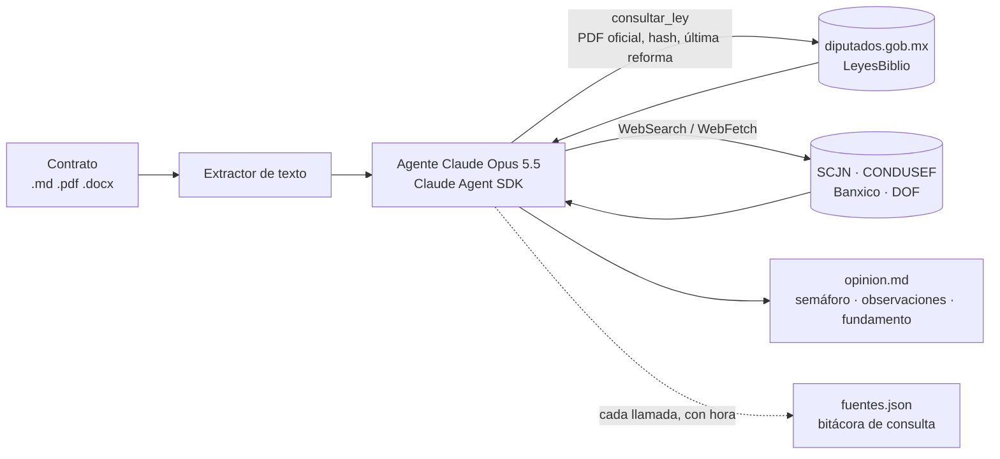
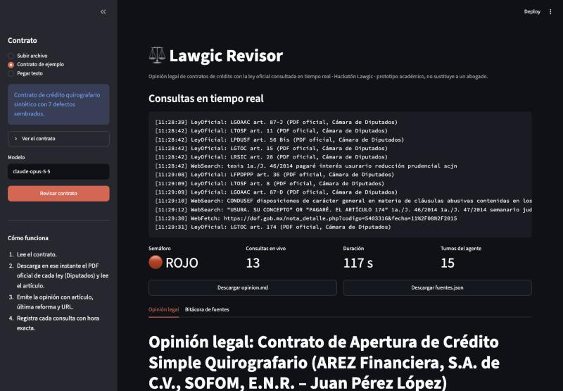

# Lawgic Revisor

**Opinión legal de contratos de crédito con la ley consultada en tiempo real.**
Proyecto de clase para el Hackatón Lawgic · 31 de octubre de 2026 · Álvaro Enríquez.

> 🌐 **Demo en línea para la revisión (31 de octubre de 2026)**: https://baseline-correspondence-llc-standard.trycloudflare.com
> Es un túnel temporal a la app corriendo en la máquina del autor; funciona mientras la demo esté encendida. Sin instalar nada: elige *Contrato de ejemplo* y pulsa *Revisar contrato*.
> 🖥️ **Pruébalo como app en tu máquina**: `streamlit run app.py` (ver [Cómo correrlo](#cómo-correrlo)).
> 🎬 Video explicativo (menos de 2 minutos): [`video/lawgic-revisor.mp4`](video/lawgic-revisor.mp4)
> 📄 Ejemplo real de salida: [`salida/contrato_quirografario_sintetico/opinion.md`](salida/contrato_quirografario_sintetico/opinion.md) y su bitácora [`fuentes.json`](salida/contrato_quirografario_sintetico/fuentes.json)

## El problema

AREZ Financiera es una SOFOM E.N.R. que firma contratos de crédito con sus clientes. Revisar cada contrato con un abogado cuesta tiempo y dinero, y pedirle la revisión a un modelo de lenguaje "a secas" tiene un defecto grave: cita artículos de memoria, a veces derogados o inventados.

## Qué hicimos

Un agente que **no puede citar una norma sin haberla leído en línea en esa misma sesión**:

1. Recibe el contrato (`.md`, `.txt`, `.pdf` o `.docx`).
2. Identifica las cláusulas con riesgo.
3. Lee el texto vigente de cada ley aplicable **en ese instante**: la herramienta propia `consultar_ley` descarga el PDF oficial de la Cámara de Diputados (LeyesBiblio), extrae el artículo y devuelve URL, hora de descarga, SHA-256 del archivo y fecha de última reforma en el DOF. Para tesis de la SCJN, disposiciones de la CONDUSEF y circulares de Banxico usa `WebSearch` y `WebFetch`.
4. Emite la opinión legal: semáforo, tabla de observaciones con artículo y URL verificada, lista de cumplimiento regulatorio y conclusión.
5. Registra **cada consulta con la hora exacta** en `fuentes.json`. Esa bitácora la genera el programa a partir de las llamadas reales a las herramientas, no el modelo: es la prueba de que la ley se consultó en tiempo real. Si una norma no se pudo verificar en línea, el agente lo dice ("no verificado en línea") en vez de citarla de memoria.



## Marco normativo que verifica

LGOAAC (arts. 87-B a 87-N, SOFOM), LTOSF (CAT, comisiones, RECA, pago anticipado), LPDUSF (cláusulas abusivas, CONDUSEF), LGTOC (apertura de crédito y pagaré), LFPDPPP (aviso de privacidad), LRSIC (buró de crédito) y los criterios de la SCJN sobre usura.

## Cómo correrlo

Requisitos: Python 3.12 y una de estas dos credenciales:

- `ANTHROPIC_API_KEY` en el entorno (o en un archivo `.env`, ver `.env.example`), **o**
- una sesión iniciada de Claude Code en la máquina (`claude auth login`), que es lo que usamos en la demo con una suscripción de claude.ai.

```bash
python3.12 -m venv .venv && .venv/bin/pip install -r requirements.txt
```

**Como app (recomendado para probar):**

```bash
.venv/bin/streamlit run app.py
```

Se abre en `http://localhost:8501`. En el panel izquierdo elige *Contrato de ejemplo* (o sube el tuyo en .md, .txt, .pdf o .docx, o pega el texto) y pulsa *Revisar contrato*. Verás las consultas a la ley apareciendo en vivo y, al terminar, el semáforo, la opinión, la bitácora de fuentes y los botones para descargar `opinion.md` y `fuentes.json`.



**Desde la terminal:**

```bash
.venv/bin/python -m lawgic_revisor ejemplos/contrato_quirografario_sintetico.md
```

Salida: `salida/<nombre del contrato>/opinion.md` y `fuentes.json`. Opciones: `--salida carpeta`, `--modelo id`, `--sin-render`.

## El contrato de prueba

[`ejemplos/contrato_quirografario_sintetico.md`](ejemplos/contrato_quirografario_sintetico.md) es un contrato de crédito simple quirografario **sintético** (partes y cifras ficticias) con siete defectos sembrados a propósito:

| # | Defecto sembrado | Norma que lo alcanza |
|---|---|---|
| 1 | Interés moratorio de 3× la tasa ordinaria (108 % anual) | Usura: criterios SCJN 1a./J. 46/2014 y 47/2014 |
| 2 | No se expresa el CAT | LTOSF art. 8 y disposiciones de Banxico |
| 3 | Comisión de 10 % por pago anticipado | LTOSF art. 10 |
| 4 | Pagaré con importe y fecha en blanco | LGTOC arts. 14 y 170 |
| 5 | Vencimiento anticipado "a su solo juicio" | LPDUSF art. 56 Bis (cláusulas abusivas) |
| 6 | Autoriza compartir datos con "cualquier tercero", sin aviso de privacidad | LFPDPPP arts. 15 a 17 y 36 |
| 7 | Renuncia a reclamar ante la CONDUSEF; sin leyenda ni RECA | LPDUSF, LGOAAC art. 87-J, LTOSF art. 11 |

Las corridas hechas desde la app se guardan en `salida/app/<contrato>_<fecha-hora>/`; hay una de muestra. El resultado de referencia (el del video) está en [`salida/contrato_quirografario_sintetico/`](salida/contrato_quirografario_sintetico/): semáforo **ROJO**, los siete defectos detectados, 12 consultas en 95 segundos (9 descargas de leyes oficiales con su fecha de última reforma y 3 búsquedas web sobre los criterios de usura de la SCJN, que el agente marcó como no verificados en fuente oficial).

## Estructura

```
app.py           app web (Streamlit) sobre el mismo motor
lawgic_revisor/
  extractor.py   texto desde .md/.txt/.pdf/.docx
  prompt.py      instrucciones del abogado revisor y fuentes preferentes
  leyes.py       herramienta consultar_ley: PDF oficial de Diputados → artículo + procedencia
  revisor.py     corre el agente, captura la bitácora de consultas, escribe los entregables
  cli.py         interfaz de línea de comandos
ejemplos/        contrato sintético de prueba
salida/          resultados reales de la demo
video/           video explicativo, guion y script que lo genera
docs/            diseño del proyecto
```

## Limitaciones y aviso

- Es un prototipo académico. **No sustituye la asesoría de un abogado.**
- Las leyes federales se leen del PDF oficial; las tesis de la SCJN y las disposiciones de la CONDUSEF dependen de páginas que a veces bloquean el acceso automatizado, y entonces el agente lo marca como no verificado.
- Cada corrida tarda unos minutos y consume tokens del modelo.
- No se incluye ningún dato real de clientes de AREZ Financiera.

## Equipo y herramientas

Álvaro Enríquez (AREZ Financiera), con Claude Opus 5.5 y el Claude Agent SDK de Anthropic. Narración del video con ElevenLabs.
